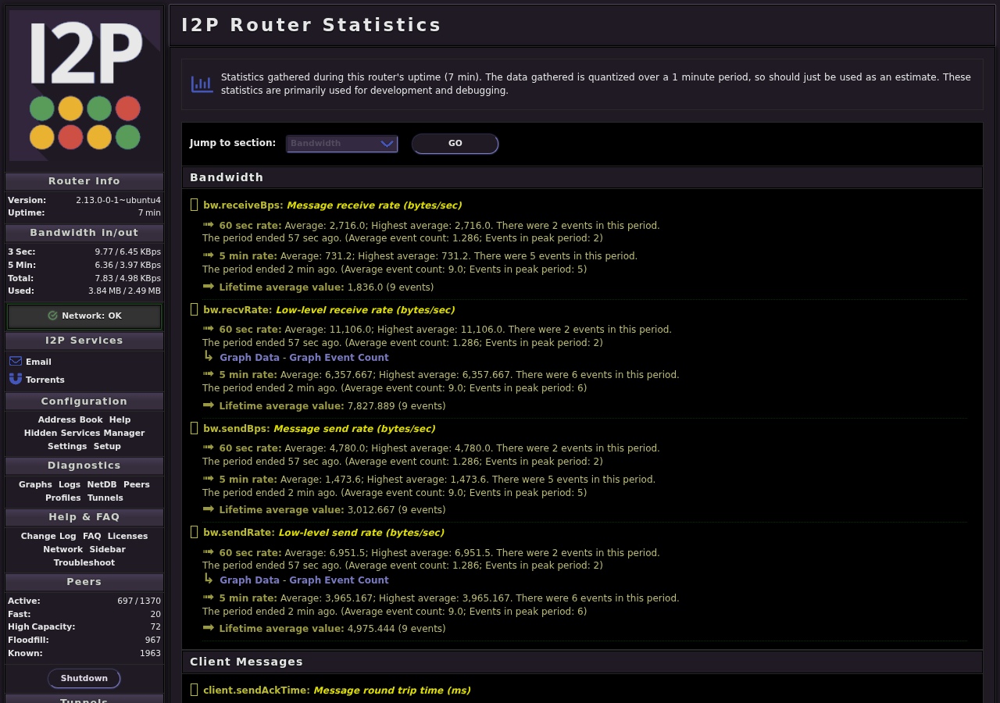
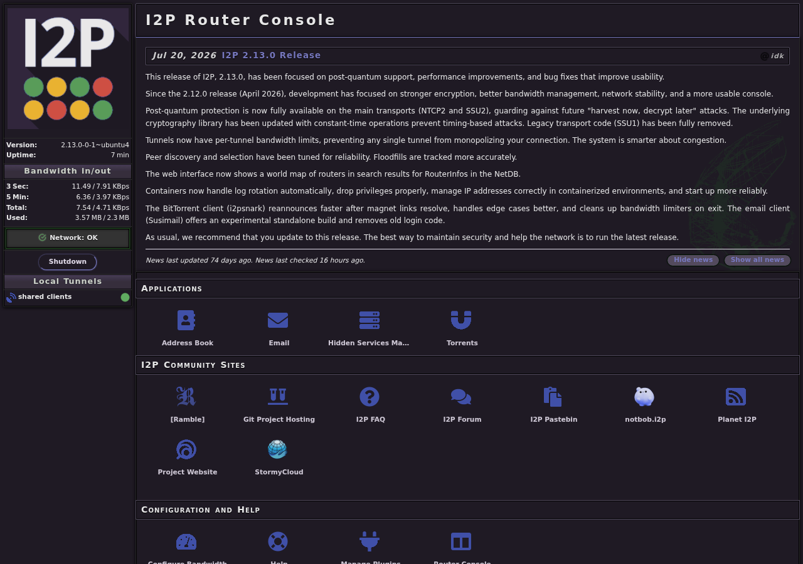

<h1>
  
  I2P pour YunoHost
</h1>

I2P est un réseau superposé anonyme et chiffré (« eepsites », tunnels, courrier I2P, partage de fichiers). Ce paquet exécute le routeur I2P officiel en natif (Java, sans Docker), avec sa console web derrière le portail YunoHost.

**Version livrée :** voir manifest.toml

## Caractéristiques

- Routeur I2P natif (Java) avec service systemd
- Console web du routeur (i2prouter console) via le portail YunoHost
- Tunnels et configuration persistants (data_dir)
- Mises à jour automatiques optionnelles du routeur (contrib)

## Liens

- Projet amont : <https://geti2p.net>
- Paquet YunoHost : <https://github.com/quartztester/i2p_ynh>

## Screenshots

